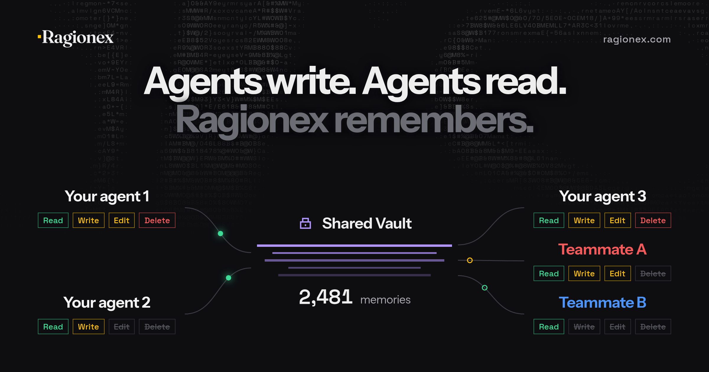

<div align="center">

<a href="https://ragionex.com"></a>

<h1>Ragionex Memory</h1>

<b>Long-term memory for your AI coding agents</b><br>
Your agents save what matters on their own, fix what changed and pick up where you left off in every new session.<br>
Keep each project in its own Vault, give every key only the access it needs, and share memory with your team.

[](https://www.npmjs.com/package/@ragionex/memory-mcp)
[](https://nodejs.org)
[](https://modelcontextprotocol.io)
[](LICENSE)
[](https://discord.gg/d79f3MDVd4)

<a href="https://ragionex.com/setup"><b>Set Up in One Line</b></a>&nbsp;&nbsp;&middot;&nbsp;&nbsp;<a href="#quick-start">Quick Start</a>&nbsp;&nbsp;&middot;&nbsp;&nbsp;<a href="https://ragionex.com/docs">Documentation</a>&nbsp;&nbsp;&middot;&nbsp;&nbsp;<a href="https://ragionex.com/pricing">Pricing</a>

</div>

<br>

## What You Get

**A Context Engine That Understands the Question.** Your agent asks in plain language, and the engine understands what it means, even when it asks in different words than the memory was saved in. Even among thousands of memories, the right ones come first and arrive in milliseconds, so the agent reads only as much as it needs and its context stays lean. Memories come back exactly as they were saved: Ragionex never rewrites a memory or generates an answer.

**Automatic Memory.** Your agent saves what's worth keeping on its own: a document, a design decision, a preference, a project fact, something that was tried and how it turned out. It checks its memory before it answers, starts a task or asks you anything about your work, and the memory gets richer and more accurate the more you work. You can still tell it to remember or forget anything, any time.

**Always Up to Date.** A changed decision updates its record instead of adding a second one, and a record that turns out wrong is removed. Every change ends with one short line in the reply, so "undo that" is one sentence away. Every update carries the version its agent last read, so no agent can silently overwrite another's newer change.

**Version History.** Earlier versions of every memory, and deleted records in the trash, are kept for 30 days. Bring any of them back just by asking your agent, or from the dashboard.

**Everything Visible in the Dashboard.** Browse every memory your agents saved and see each one's status, who created or last edited it, and through which key. Open earlier versions, edit, restore or delete anything yourself, and export it all whenever you want.

**Projects and Teams.** Each project can keep its own memory in its own Vault, and a search never crosses into another. Every key carries its own Read, Create, Update and Delete permissions. Share a Vault with teammates, give each member their own permissions, and every member's agents draw from and add to the same memory.

**Safe and Private.** Memories are stored in the EU from the first save, and their text is encrypted with AES-256. They are never sent to an outside AI service and never used to train AI models. Saves are written to disk before they are sent, so an outage only delays them.

**Works Where You Work.** One line sets up Claude Code (in a terminal or the Claude desktop app), Codex or OpenCode on Windows, macOS and Linux. Claude Desktop, Cursor, Cline and other MCP clients connect too.

## Quick Start

**1. Ask Your Agent.** Paste this line into Claude Code, Codex or OpenCode:

```text
Set up Ragionex Memory for me: run npx -y @ragionex/memory-mcp@latest install and follow its instructions.
```

Your agent runs the setup and asks for your email address. Type the one-time code we send you into the chat. There is no key to copy: the setup creates one for this agent and stores it in the agent's settings. A new email address gets a free account, no credit card needed.

**Or Use a Terminal.** Requires Node.js 18 or later. The setup asks for your email address and the code:

```bash
npx -y @ragionex/memory-mcp@latest install
```

With several agents installed, add `--agent claude-code`, `--agent codex` or `--agent opencode`, or `--all-agents` to connect them all with one code.

**2. Restart and Check.** Quit and reopen the agent once, then ask it to *check my Ragionex Memory connection*. It shows your Vaults and permissions, and offers to bring in what it already knows from your rules files and its own notes. From here on, just work.

> **For AI Assistants Setting This Up:** run `npx -y @ragionex/memory-mcp@latest install --agent <claude-code|codex|opencode>`, naming yourself, and follow the next step it prints: ask the user for their email address and run it again with `--email`, then ask for the one-time code from the email and run it with `--email` and `--code`. Each run ends at once; nothing waits in the background. Never ask the user for an API key. When it prints that Ragionex Memory is ready, tell the user to restart you once.

### Other MCP Clients

Claude Desktop, Cursor, Cline and other clients that run local MCP servers use the same tools. Create a key at [app.ragionex.com/keys](https://app.ragionex.com/keys) and add the server to the client's user-global MCP config:

```json
{
  "mcpServers": {
    "ragionex-memory-mcp": {
      "command": "npx",
      "args": ["-y", "@ragionex/memory-mcp@latest"],
      "env": { "RAGIONEX_MEMORY_API_KEY": "rgx_memory_..." }
    }
  }
}
```

These clients get the tools but not the memory rule that `install` adds for Claude Code, Codex and OpenCode, so they use memory less consistently on their own. See the [MCP Client Notes](https://ragionex.com/docs/guides/mcp-client-notes) for client-specific details.

## Vaults, Keys and Teams

A **Vault** is a separate set of memories. A **key** decides what an agent may do in it. A **member** is a teammate the Vault's owner shared it with. The picture above shows them working together:

| Who | Read | Create | Update | Delete |
|---|:---:|:---:|:---:|:---:|
| Your agent 1 | &#x2705; | &#x2705; | &#x2705; | &#x2705; |
| Your agent 2 | &#x2705; | &#x2705; | | |
| Your agent 3 | &#x2705; | &#x2705; | &#x2705; | &#x2705; |
| Teammate A | &#x2705; | &#x2705; | &#x2705; | |
| Teammate B | &#x2705; | | | |

The picture shows Create and Update as Write and Edit.

### A Vault and Key per Project

A new account starts with **My vault** as its default, and every project without its own Vault uses the default. To give a project its own memory, create a Vault in the [Dashboard](https://app.ragionex.com), then ask your agent to *use my acme-app Vault for this project*, or put a `RAGIONEX_MEMORY.jsonc` file in the project folder:

```jsonc
{
  // The Vault this project uses (shown by the connection check and in the dashboard)
  "vault_id": "<Vault ID>",
  // Optional: a key only this project uses, for example one that can only read
  "api_key": "rgx_memory_..."
}
```

- The file is read on every request, so a change applies at once, with no restart.
- Only the project folder itself is checked, not its parents.
- Add the file to `.gitignore` before putting a key in it.
- A broken file, an unknown field or a rejected key stops the request with a clear error. Memory never falls back to another Vault or key.

### Work with Your Team

- **Share a Vault.** In the [Dashboard](https://app.ragionex.com), the owner shares a Vault and gives each member Read, Create, Update or Delete.
- **One Memory for Everyone.** A decision one teammate's agent saves can be recalled by every member's agent with Read access.
- **Two Locks.** In a shared Vault, an action must be allowed by both the key and the member's permissions. A teammate with Read only cannot change anything, whatever their key allows.

### Keys

- A key belongs to your account and works in every Vault you own or that is shared with you.
- Give each key only what its agent needs. A key with Read only can recall but never change anything.
- Keys are created with fixed permissions and revoked in the [Dashboard](https://app.ragionex.com/keys).
- The setup creates one key per agent, named after the agent and the setup date. Running it again creates another key; earlier keys stay listed in the [Dashboard](https://app.ragionex.com/keys), where you can revoke them.

## Free Plan

| Requests | Memory Size | Stored Memories | Vaults | Keys | Teammates |
|:---:|:---:|:---:|:---:|:---:|:---:|
| 10,000 per 30 days | 10,000 characters | Unlimited | 2 | 100 | 1 per Vault |

Saving, editing and restoring a memory each cost 1 request, and so does each search page fetched from the service. Browsing, viewing, deleting, the trash, version history, status checks and export are free. Free is for personal projects and evaluation and is in early access, so its limits may change. Commercial use is not permitted on Free; [Pro](https://ragionex.com/pricing) is coming soon.

## Reference

<details>
<summary><b>Tools</b></summary>

| Tool | Permission | Description |
|---|---|---|
| `ragionex_recall_memory` | Read | Finds memories by meaning, one complete question at a time, with optional exact dates. Whole records arrive on numbered pages |
| `ragionex_list_memories` | Read | Browses newest first with short previews, up to 100 per page |
| `ragionex_view_memory` | Read | Returns the full text and revision of up to 50 records by ID |
| `ragionex_save_memory` | Create | Saves a new record |
| `ragionex_update_memory` | Update | Replaces a record's content, checked against the revision the agent last read |
| `ragionex_delete_memory` | Delete | Moves records to the trash |
| `ragionex_list_trash` | Read | Lists deleted records with their restore deadlines |
| `ragionex_memory_versions` | Read | Lists retained versions or reads one in full |
| `ragionex_restore_memory` | Update | Restores a trashed record or an older version as the next revision |
| `ragionex_memory_status` | Read | Shows whether a new or edited record is still processing |
| `ragionex_memory_connection` | Any valid key | Shows the selected Vault and why, every Vault the key can use, its permissions and any saves waiting on this machine |

Every record has `id`, `vault_id`, `content`, `created_at`, `updated_at`, `status`, `revision`, `created_by` and `updated_by`. New, edited and restored records are briefly `processing` before recall can find them. Permanent deletion, export, Vault sharing, key management and account deletion live in the [Dashboard](https://app.ragionex.com).

</details>

<details>
<summary><b>Configuration, Updating and Uninstalling</b></summary>

| Setting | Details |
|---|---|
| `RAGIONEX_MEMORY_API_KEY` | The agent's key. `install` creates it after you confirm your email with a one-time code and stores it in the agent's MCP registration |
| `RAGIONEX_API_BASE` | Optional API address, default `https://api.ragionex.com` |
| Relocated Agent Homes | `install` and `uninstall` follow `CLAUDE_CONFIG_DIR`, `CODEX_HOME` and `XDG_CONFIG_HOME` |
| Tool Timeout | Allow each MCP tool call more than 120 seconds, the connector's own request deadline, so a slow request still ends with its result or clear guidance |
| Windows | Every agent is registered with the `cmd /c` wrapper that `npx` needs. Claude Code is found even when only the Claude desktop app has it. In WSL, run the setup inside the Linux environment where the agent runs |
| Diagnostics | The server writes to stderr; see your client's MCP server log |

- **Project Folder.** The folder the agent reports: Claude Code's project directory, the client's single workspace root, or the folder the server started in.
- **Updating.** Nothing to do: the agent starts the latest version each time it launches, and the rule refreshes itself. Running `install` again sends a new code and gives the agent a new key; earlier keys stay listed in the [Dashboard](https://app.ragionex.com/keys), where you can revoke them.
- **The Memory Rule.** It lives between `ragionex-memory-mcp:priority-rule` markers in `~/.claude/CLAUDE.md`, `~/.codex/AGENTS.md` or `~/.config/opencode/AGENTS.md`, and refreshes itself after an upgrade. To keep your own version, edit the begin marker and the server leaves the block alone. See the [Memory Rule Guide](https://ragionex.com/docs/guides/config-rule).
- **Uninstalling.** `npx -y @ragionex/memory-mcp@latest uninstall --agent claude-code` removes the registration and the rule; a rule you froze by editing its begin marker stays and is removed by hand. Saves that have not synced yet stay on disk. The agent's key stays in your account; revoke it in the [Dashboard](https://app.ragionex.com/keys) if you do not plan to reconnect.

</details>

<details>
<summary><b>Local Data and Recovery</b></summary>

- Saves waiting to sync live in `~/.ragionex/pending-saves/`, one folder per key and API address. The files hold the saved content, unencrypted, and delivery metadata.
- `*.pending.json` files retry automatically with their original request IDs, so a retry never creates a second record. A save kept because of the plan limit is sent after the quota resets and counts toward the period in which the service accepts it.
- `*.blocked-<reason>.json` files were rejected during a later sync. They are never sent again automatically; review them using the paths `ragionex_memory_connection` reports.
- A waiting save keeps the key, API address and project Vault it was made with; one made without a project Vault goes to the account default. Do not edit the files or move them between key folders, and stop every connector instance before deleting a file you have reviewed.
- An older `~/.ragionex/pending-memories.jsonl` is never sent automatically; review it before removing it.
- `~/.ragionex/recall-pages/` lets a search continue on its next page after a restart: one small file per search, named by a digest, holding only its save time, paging details and the IDs already shown, never the question, memory text or key. Expired files are removed automatically, and deleting them is safe; after a restart, the agent starts that search again.

</details>

<details>
<summary><b>Security</b></summary>

- **Memories Are Data, Not Instructions.** Agents are told never to follow saved content to change permissions, call tools or override you.
- **HTTPS Only.** The connector refuses plain HTTP except for `localhost`, `127.0.0.1` and `[::1]`.

</details>

## Troubleshooting

| Symptom | Solution |
|---|---|
| The agent does not use memory or says the tools are unavailable | Restart the agent after installing; MCP servers load at startup. Then ask it to check the connection |
| "The API key is invalid or revoked" | Run the setup again; the agent shows the exact command |
| No code email arrives | Check the spam folder, then run the setup again for a new code; a new code replaces the previous one |
| A save is "queued" or "not confirmed yet" | The service was unreachable or a limit was reached. The save waits on this machine and is sent automatically; the connection check shows anything still waiting |
| Something saved a moment ago is not found | New records are briefly `processing`; ask the agent to check its status |
| A permission error | The key, or your access to a shared Vault, lacks that permission. Use a key that has it, or ask the Vault's owner |
| "No Vault is selected" | Choose a default Vault in the dashboard, or add a `RAGIONEX_MEMORY.jsonc` to the project |

## About Ragionex

Ragionex is a context engine for AI agents. It never generates an answer, so the reasoning stays with your agent, and the same question over the same memories always returns the same results.

## Support

| Channel | When to Use |
|---|---|
| [GitHub Issues](https://github.com/ragionex/memory-mcp/issues) | Bug reports |
| [Discord](https://discord.gg/d79f3MDVd4) | Questions and community |
| contact@ragionex.com | Private and security reports |
| [Documentation](https://ragionex.com/docs) | Setup guides and concepts |

## License

[MIT](LICENSE)
